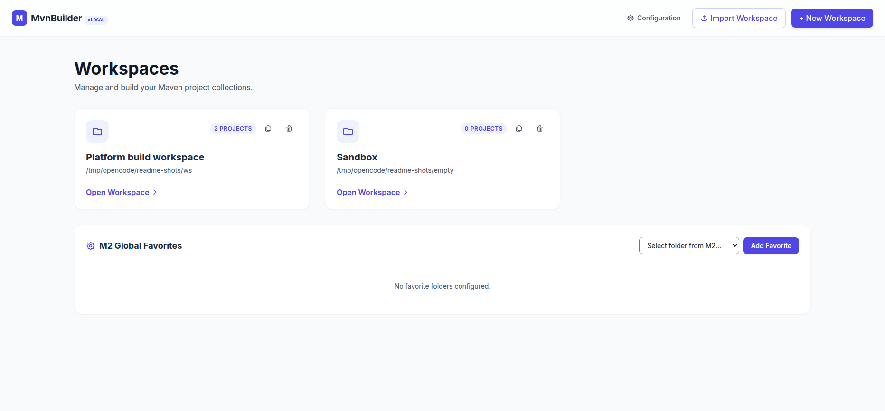
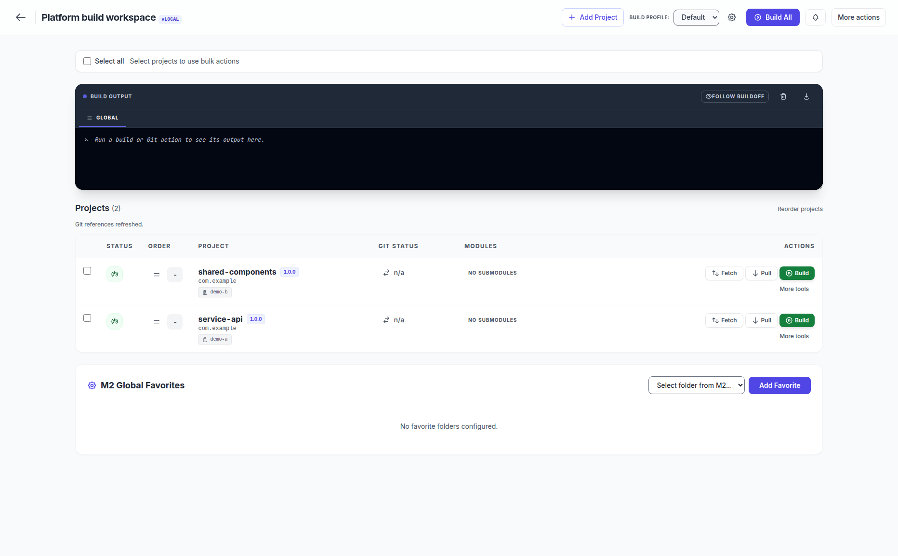
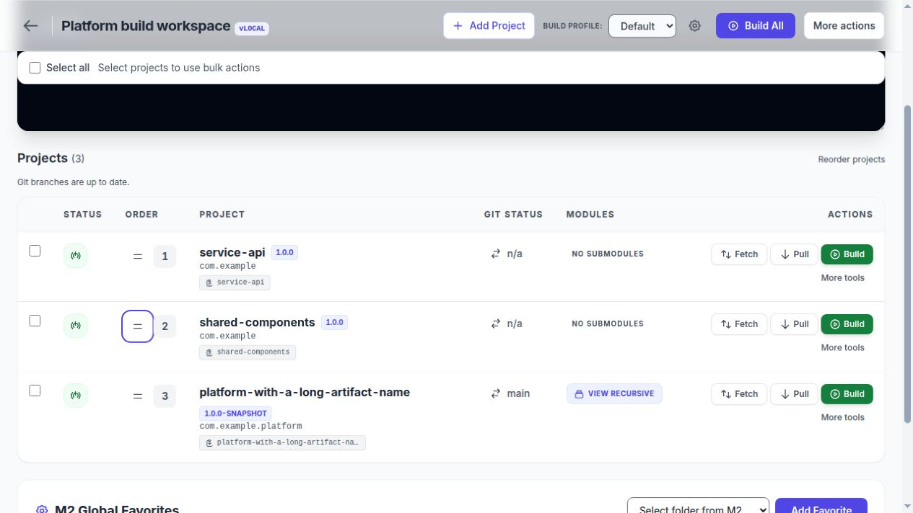
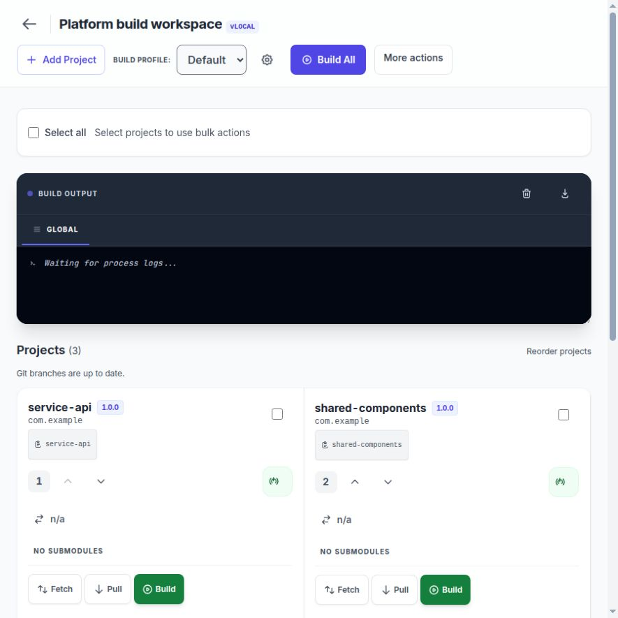
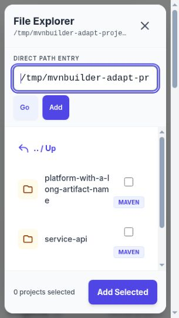
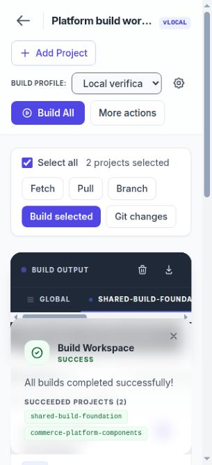

# MvnBuilder - Maven Workspace Manager & Builder

MvnBuilder is a robust administrative dashboard designed to manage complex Maven project structures. It provides a centralized interface for discovering projects, managing dependencies, executing builds with custom profiles, and maintaining the local M2 repository.

## 🚀 Key Features




### 🛠️ Advanced Build Management
- **Multiple Build Profiles**: Define and store custom Maven commands (e.g., `-B clean install`, `-B package -DskipTests`). Switch between profiles instantly with a single click.
- **Real-time Log Streaming**: Watch your build progress live via WebSockets.
- **Process Control**: Monitor the active process **PID**, see the exact **execution duration**, and **terminate (Kill)** any running build if needed.
- **Topological Sorting**: Automatically calculates the correct build order based on project dependencies, ensuring parent projects wait for children.




### 🧹 M2 Repository Maintenance
- **Physical Folder Discovery**: Scans your `~/.m2/repository` to find actual physical parent folders (Group IDs).
- **Targeted Deletion**: Select specific repository branches to delete recursively, helping you clean up corrupted artifacts or free up space without wiping the entire repository.
- **Favorites**: Mark frequently cleaned Group IDs as favorites for quick access.

### 📂 Workspace Organization
- **Project Discovery**: Automatically finds Maven projects within a base path.
- **Bulk Actions**: Perform Git Fetch, Pull, or Maven Build on multiple selected projects simultaneously.
- **Drag & Drop Reordering**: Manually override the build order using an intuitive interactive list.

### Workspace Git view

Choose **Git** in a workspace to review the repositories of its projects, including disabled, folder, imported and outside-base projects. Compare staged and unstaged files with syntax highlighting, stage or unstage selected lines/blocks, edit a file before committing, commit exactly the marked files in one or several repositories after a confirmation (optionally with push), and run fetch, pull, push, publish, stash, or confirmed discard actions. A synchronization overview lists commits to push and pull per repository and branch, and changed-repository and operation paths can be downloaded. Panes are resizable and selected repositories can be pushed together. See [Workspace Git guide](docs/workspace-git.md) for comparisons, operation boundaries, configuration, and verification.

Use **Add Project → Include non-Maven folders** to register other project directories explicitly. Windows terminal shortcuts open PowerShell. After a sequential build failure, **Skip and continue** resumes the pending projects without disabling the failed project. See [Manual projects and build recovery](docs/manual-projects-and-build-recovery.md) for behavior and verification limits.

### 📱 Responsive Design
MvnBuilder adapts to desktop, tablet, and mobile screens.

| Desktop | Tablet |
| --- | --- |
|  |  |

| Mobile explorer | Mobile view |
| --- | --- |
|  |  |

---

## 🤖 Built with AI

This project is a testament to the power of modern Agentic AI. Development has been supported by **Antigravity** and **Codex**, using a multi-model workflow across several model generations.

### Models used

- Gemini 3.1 Pro
- Gemini 3 Flash
- Gemini 3.5
- Gemini 3.7
- Gemini 3.8
- Claude 4.6 Opus
- GPT-5.6 Luna
- GPT-5.6 Terra
- GPT-5.6 Sol
- GPT-6 Astra
- GPT-6 Sol

---

## 🛠️ Technology Stack

- **Backend**: Spring Boot 3.2.5 (Java 21)
- **Data Layer**: Spring Data JPA with H2 Database
- **Frontend**: Thymeleaf, Tailwind CSS, HTMX
- **Real-time**: WebSockets with STOMP & SockJS
- **Build System**: Maven (Native support for GraalVM)

Frontend CSS is precompiled and JavaScript dependencies are bundled with fixed
versions. See [Frontend assets](frontend/README.md) to rebuild styles or update
vendor scripts; normal Maven builds need no Node.js installation.

---

## 🏁 Getting Started

### Prerequisites
- Java 21+
- Maven 3.9+

### Default Port
The application runs on port **3333** by default. You can change this by setting the `SERVER_PORT` environment variable or modifying `src/main/resources/application.properties`.

### 🚀 Running the Application

#### 1. Standard Java JAR
```bash
java -jar target/mvn-builder.jar
```

* **Service Mode by Default**: When launching the packaged `.jar` file, the application automatically registers itself for startup autostart on system boot (via systemd on Linux, startup batch script on Windows, or LaunchAgent on macOS), starts the background service, and exits the foreground terminal process immediately.
* **Foreground Mode (`--no-service`)**: To run the application in the foreground attached to your terminal, launch the JAR with the `--no-service` argument:
  ```bash
  java -jar target/mvn-builder.jar --no-service
  ```

#### 2. Native Binary (Linux/macOS/Windows)
```bash
# Linux/macOS
./mvn-builder

# Windows
mvn-builder.exe
```
*Note: Running in development mode (e.g. from IDE/run scripts) or running as a native binary runs the application in the foreground by default without registering autostart services.*

#### 3. Docker Compose (Recommended)
Download the `docker-compose.yml` file and run:
```bash
curl -O https://raw.githubusercontent.com/jonolabarrieta/maven-builder-web-ui/main/docker-compose.yml
docker compose up -d
```
*Note: This will use the image from GHCR and persist data in `./data`.*

#### 4. Docker Run
```bash
docker run -d \
  -p 3333:3333 \
  -v $(pwd)/data:/app/data \
  -v $(pwd)/workspaces:/workspaces \
  ghcr.io/jonolabarrieta/maven-builder-web-ui:latest
```

### Development Mode
```bash
./run.sh
```
The application will be available at `http://localhost:3333`.

---

## 📄 License

Licensed under the **Apache License, Version 2.0**. See the [LICENSE](LICENSE) file for details.

---

*Crafted with precision by net.olaba & Antigravity AI.*

## References

Agents document is based on the guidelines found at [Agents.md for Java and Spring Boot](https://josealopez.dev/en/blog/agents-md-java-spring-boot).

See [Parent workspaces and project groups](docs/workspace-groups.md) for shared collections, local groups, scoped actions, portable configuration and migration.
